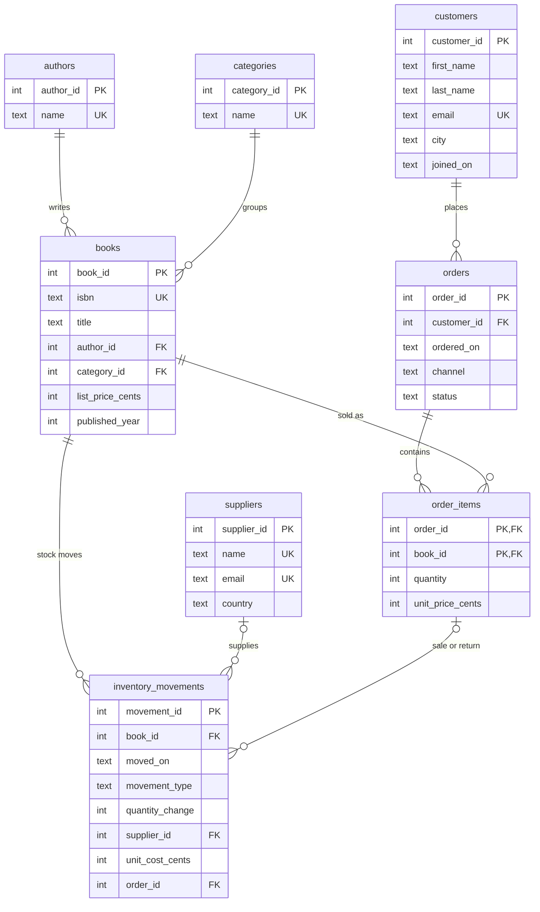

# SQL Bookstore Analytics

A small relational database for an independent bookstore, plus 20 business questions answered in SQL. It runs on SQLite with no server and no setup. All data is **synthetic** (made up by `seed.py`, seed 42). No real customers, books or sales are in this repo.

## What it is

- `schema.sql`: 8 tables in third normal form, with primary keys, foreign keys, CHECK and UNIQUE constraints, and indexes.
- `seed.py`: builds `bookstore.db` from `schema.sql` and fills it with synthetic data: 60 authors, 8 categories, 6 suppliers, 160 books, 450 customers, 2,000 orders (3,186 order lines) and 3,389 stock movements. Orders run from 2024-01-01 to 2025-12-31.
- `queries/01..20_*.sql`: one business question per file. Each file has the question, the query, a one-line reading of the result, and a sample of the real output.
- `run_queries.py` and `run.ps1`: rebuild the database and run every query.
- `PRACTICE.md` and `PRACTICE_ANSWERS.md`: 10 exercises and their answers.
- `WALKTHROUGH.md`: every file explained in plain English.

The queries use joins, CTEs, window functions, `HAVING`, and subqueries.

## How to run

You need Python 3 and PowerShell. Nothing else: the `sqlite3` module ships with Python. This was tested on Python 3.12.10 with SQLite 3.49.1. `schema.sql` uses `STRICT` tables, which need SQLite 3.37 or newer.

```powershell
git clone https://github.com/YazanAlshareef/sql-bookstore-analytics.git
cd sql-bookstore-analytics
powershell -ExecutionPolicy Bypass -File .\run.ps1
```

`run.ps1` runs `python seed.py` (deletes and rebuilds `bookstore.db`), then `python run_queries.py` (runs all 20 queries and prints up to 10 rows each). It stops with a non-zero exit code if the seed or any query fails.

To run one or two queries: `python run_queries.py 07 14`. To refresh the sample output pasted inside each `.sql` file: `python run_queries.py --write-samples`.

## Entity relationship diagram



`inventory_movements` also has a composite foreign key `(order_id, book_id)` to `order_items`, so a sale or return must point at a real order line.

## Why third normal form

Every non-key column depends on the key, the whole key, and nothing but the key.

- Author and category names live once, in `authors` and `categories`. A book holds only the id. Renaming an author is one `UPDATE`.
- Customer details live in `customers`; an order holds only `customer_id`.
- `order_items` has a composite key `(order_id, book_id)`. Quantity and price depend on that pair, not on the order or the book alone.
- `order_items.unit_price_cents` is the price paid on that day. It is a historical fact (a discount can differ from the list price), so it is not a copy of `books.list_price_cents` and does not break 3NF.
- Stock on hand is **not stored**. It is the sum of `inventory_movements.quantity_change` for a book. A stored count could drift from the movements; a sum cannot.
- Money is stored as integer cents and dates as ISO text (`YYYY-MM-DD`), so there is no float rounding and dates sort correctly.

## What the schema enforces, and what it does not

Enforced by the database: primary keys, foreign keys (`ON DELETE RESTRICT`), `NOT NULL`, `UNIQUE` (emails are case-insensitive), `CHECK` on status, channel, positive quantity and price, valid dates, 13-digit ISBN, and one `CHECK` per movement type. Partial unique indexes allow one sale and one return per order line.

Not enforced (it needs a trigger, which I did not write): a sale only on a non-cancelled order, a return only on a `returned` order, a return dated on or after its sale, a `returned` order that has a return row, an order with at least one line, and stock never below zero. The queries filter on `orders.status` instead. `seed.py` asserts that the final stock of every book is not negative. It does not check the running balance on each day, which can dip below zero in the seed data because a return is dated days after its sale.

## Differences for PostgreSQL

The DDL follows standard SQL where practical, but I **have not run it on PostgreSQL**. To port it you would change:

| SQLite (this repo) | PostgreSQL |
|---|---|
| `STRICT` table option | remove it; PostgreSQL columns are already typed |
| dates as `TEXT`, checked with `date(x) IS x` | `DATE` columns |
| ISBN check with `GLOB` | `isbn ~ '^[0-9]{13}$'` |
| `INTEGER PRIMARY KEY` | `GENERATED ALWAYS AS IDENTITY` |
| `email ... COLLATE NOCASE` | unique index on `lower(email)` |
| partial indexes (`WHERE ...`) | work as they are |

The queries use SQLite functions (`substr`, `julianday`, summing a comparison such as `SUM(status = 'cancelled')`). Those need rewriting too, for example with `date_trunc`, date subtraction, and `SUM((status = 'cancelled')::int)`.

## How AI helped

I used an AI coding assistant to draft the schema, `seed.py`, the 20 queries and the runner, working from a brief I set. I checked the work by running it. An AI review of the first schema found real problems (next section). The one-line readings were written from the printed numbers; some were wrong the first time, and I caught them by comparing against the output and rewrote them.

## What broke and how it was fixed

- A date `CHECK` such as `date(x) = x` lets garbage through: `date('garbage')` is `NULL`, and a `CHECK` only rejects `FALSE`, not `NULL`. Fixed with `date(x) IS x`.
- Tables were not `STRICT`, so a text value could be stored in an `INTEGER` column. Fixed with `STRICT`.
- A stock movement could point at an order line that did not exist. Fixed with a composite foreign key to `order_items`.
- The same order line could be sold twice in the ledger. Fixed with partial unique indexes.
- Foreign keys used `CASCADE`, which would silently delete order history. Changed to `RESTRICT`.
- Emails were case-sensitive, so `A@x.com` and `a@x.com` counted as different customers. Fixed with `COLLATE NOCASE`.
- A price expression in `seed.py` was garbled. Rewritten.
- Writing the 20 query files from a shell here-document failed. I wrote them another way, and they are plain `.sql` files in `queries/`.
- The readings for Q03 and Q16 did not match their output. Both were rewritten against the real output.
- There is no `sqlite3` command-line tool on this machine, so every query runs through Python's `sqlite3` module.

## Limits

- The data is synthetic and random in places, so patterns in the results come from the generator, not from real shoppers. Do not read them as business facts.
- Sample output is the first 10 rows of each query. The total row count is stated in each block.
- Tested on one machine: Windows, Python 3.12.10, SQLite 3.49.1. Not tested on Linux or macOS, and not tested on PostgreSQL.
- No triggers and no stored procedures. The only automated checks are the ones in `seed.py` (integrity check, foreign key check, row counts, final stock not negative, no empty orders) and the fact that every query runs.
- Amounts are shown in currency units (cents divided by 100). No currency is named.

## The 20 questions and their real output

Each block below is the output of `python run_queries.py` on the seed-42 database. The full SQL is in the linked file.

### Q01. How much did the shop earn each month, what is the running total, and how did each month change from the one before?

Reading: Monthly revenue grows from 967.30 in 2024-01 to 10095.46 in 2025-12, with the biggest jump in 2025-11 (+83.3%); the running total ends at 81263.93.

SQL: [`queries/01_monthly_revenue.sql`](queries/01_monthly_revenue.sql). Output (first 10 of 24 rows, seed 42 data):

```text
month    revenue  running_total  pct_change_vs_prev
-------  -------  -------------  ------------------
2024-01  967.3    967.3
2024-02  867.08   1834.38        -10.4
2024-03  1154.29  2988.67        33.1
2024-04  1246.06  4234.73        8.0
2024-05  1492.56  5727.29        19.8
2024-06  2353.57  8080.86        57.7
2024-07  2206.74  10287.6        -6.2
2024-08  1444.54  11732.14       -34.5
2024-09  1800.18  13532.32       24.6
2024-10  2082.11  15614.43       15.7
```

### Q02. Which 10 books earn the most revenue?

Reading: One title, The Last River, earns 7578.40 from 320 units, about 47% more than the runner-up (5168.14).

SQL: [`queries/02_top_books_by_revenue.sql`](queries/02_top_books_by_revenue.sql). Output (10 rows, seed 42 data):

```text
rank  title               author       units  revenue
----  ------------------  -----------  -----  -------
1     The Last River      Ava Patel    320    7578.4
2     The Lost River      Amir Garcia  146    5168.14
3     The Hidden Orchard  Liam Cohen   196    4634.84
4     The Salt River      Mia Fox      111    3499.69
5     The Red Garden      Ava Cohen    85     3107.15
6     The Silver Archive  Oscar Patel  104    2971.46
7     The Paper Engine    Ethan Singh  88     2779.92
8     The Broken Orchard  Noah Novak   79     2426.51
9     The Lost Letter     Chloe Khan   42     1390.18
10    The Silver Kitchen  Ava Hughes   43     1265.57
```

### Q03. What are the 3 best-selling books (by revenue) inside each category?

Reading: Cooking's top book (3107.15) earns almost four times the second (825.34); Children is the closest race (529.14 against 500.49).

SQL: [`queries/03_top3_books_per_category.sql`](queries/03_top3_books_per_category.sql). Output (first 10 of 24 rows, seed 42 data):

```text
category   rank_in_category  title               revenue
---------  ----------------  ------------------  -------
Biography  1                 The Salt River      3499.69
Biography  2                 The Broken Orchard  2426.51
Biography  3                 The Silver Kitchen  1265.57
Children   1                 The Burning Border  529.14
Children   2                 The Salt Garden     500.49
Children   3                 The Lost Atlas      401.09
Cooking    1                 The Red Garden      3107.15
Cooking    2                 The Winter Signal   825.34
Cooking    3                 The Burning Planet  792.69
Fiction    1                 The Hidden Orchard  4634.84
```

### Q04. What share of total revenue does each category bring, and how fast does the cumulative share build up?

Reading: Science, Biography and Science Fiction together bring 54.2% of revenue; Children is the smallest at 4.2%.

SQL: [`queries/04_category_revenue_share.sql`](queries/04_category_revenue_share.sql). Output (8 rows, seed 42 data):

```text
category         revenue   share_pct  cumulative_share_pct
---------------  --------  ---------  --------------------
Science          16056.87  19.8       19.8
Biography        14474.63  17.8       37.6
Science Fiction  13477.53  16.6       54.2
Cooking          11615.3   14.3       68.4
Fiction          9448.46   11.6       80.1
History          6855.53   8.4        88.5
Mystery          5943.04   7.3        95.8
Children         3392.57   4.2        100.0
```

### Q05. Which authors have at least 3 different titles sold and at least 40 units sold in total?

Reading: Ava Patel leads with 7 titles and 474 units (10548.46); 20 authors pass the 3-title and 40-unit bar.

SQL: [`queries/05_prolific_authors.sql`](queries/05_prolific_authors.sql). Output (first 10 of 20 rows, seed 42 data):

```text
author        titles_sold  units  revenue
------------  -----------  -----  --------
Ava Patel     7            474    10548.46
Liam Cohen    3            243    5518.17
Mia Fox       6            240    6003.7
Oscar Patel   5            145    4003.65
Ava Cohen     7            144    4552.26
Jack Wilson   6            102    2085.98
Sam Bell      5            89     2202.61
Ava Hughes    4            80     2213.2
Grace Taylor  4            79     1481.01
Max Lee       3            73     1469.87
```

### Q06. Who are the 10 biggest customers, and what share of all revenue do they bring?

Reading: The top customer, Omar Kim, brings 2.77% of revenue and the top 10 each bring between 1.16% and 2.77%, so no single customer dominates.

SQL: [`queries/06_top_customers.sql`](queries/06_top_customers.sql). Output (10 rows, seed 42 data):

```text
rank  customer     city       orders  revenue  share_of_all_revenue_pct
----  -----------  ---------  ------  -------  ------------------------
1     Omar Kim     Geelong    43      2249.9   2.77
2     Yuki Park    Melbourne  42      1955.49  2.41
3     Isla Fox     Melbourne  42      1919.2   2.36
4     Amir Chen    Melbourne  44      1670.7   2.06
5     Ruby Cohen   Hobart     37      1665.41  2.05
6     Noah Clarke  Brisbane   35      1520.23  1.87
7     Ava Wilson   Adelaide   26      1334.86  1.64
8     Mateo Khan   Melbourne  25      1208.02  1.49
9     Sam Haddad   Brisbane   21      1051.8   1.29
10    Liam Novak   Canberra   19      939.21   1.16
```

### Q07. How many customers bought once, twice, or three or more times?

Reading: 56.6% of buyers ordered three or more times; only 17.7% ordered once.

SQL: [`queries/07_repeat_customers.sql`](queries/07_repeat_customers.sql). Output (3 rows, seed 42 data):

```text
bucket     customers  pct_of_buyers
---------  ---------  -------------
1 order    70         17.7
2 orders   102        25.8
3+ orders  224        56.6
```

### Q08. Which cities have customers who signed up but never completed an order?

Reading: 54 customers across 8 cities never completed an order; Geelong has the most (10).

SQL: [`queries/08_customers_without_orders.sql`](queries/08_customers_without_orders.sql). Output (8 rows, seed 42 data):

```text
city       customers_without_completed_order
---------  ---------------------------------
Geelong    10
Hobart     9
Adelaide   7
Perth      7
Sydney     7
Brisbane   6
Canberra   4
Melbourne  4
```

### Q09. What is the average, smallest and largest order value for in-store and online orders?

Reading: Online has more orders (996 vs 853) but the average order is about the same (43.36 online, 44.64 in store).

SQL: [`queries/09_order_value_by_channel.sql`](queries/09_order_value_by_channel.sql). Output (2 rows, seed 42 data):

```text
channel   orders  avg_order_value  smallest  largest  revenue
--------  ------  ---------------  --------  -------  --------
online    996     43.36            7.19      194.12   43189.2
in_store  853     44.64            7.19      188.53   38074.73
```

### Q10. Which frequent customers (4+ completed orders) come back the fastest, measured by average days between orders?

Reading: Ruby Cohen orders about every 1.2 days on average over 37 orders, the fastest repeat buyer.

SQL: [`queries/10_days_between_orders.sql`](queries/10_days_between_orders.sql). Output (10 rows, seed 42 data):

```text
customer      orders  avg_days_between_orders  shortest_gap  longest_gap
------------  ------  -----------------------  ------------  -----------
Ruby Cohen    37      1.2                      0.0           4.0
Liam Novak    19      2.1                      0.0           5.0
Nora Walker   5       4.0                      2.0           8.0
Leila Hughes  9       4.8                      0.0           10.0
Lucas Singh   7       4.8                      1.0           11.0
Isla Fox      42      5.6                      0.0           26.0
Ruby Novak    11      6.0                      2.0           17.0
Ava Chen      4       6.7                      1.0           11.0
Max Martin    4       7.0                      1.0           17.0
Grace Singh   10      8.3                      1.0           23.0
```

### Q11. Each month, how many buying customers are new (first completed order that month) and how many are returning?

Reading: New buyers per month stay between 9 and 26 over the 24 months, while returning buyers grow from 0 in 2024-01 to 113 in 2025-12.

SQL: [`queries/11_new_vs_returning.sql`](queries/11_new_vs_returning.sql). Output (first 10 of 24 rows, seed 42 data):

```text
month    new_customers  returning_customers
-------  -------------  -------------------
2024-01  15             0
2024-02  17             3
2024-03  17             5
2024-04  13             13
2024-05  18             12
2024-06  16             20
2024-07  26             23
2024-08  12             19
2024-09  13             25
2024-10  14             25
```

### Q12. What share of orders is cancelled or returned, by year and channel?

Reading: Cancel and return rates stay between 2.8% and 5.1%; the highest is the 5.1% cancel rate for in-store orders in 2024.

SQL: [`queries/12_cancel_and_return_rate.sql`](queries/12_cancel_and_return_rate.sql). Output (4 rows, seed 42 data):

```text
year  channel   orders  cancelled  returned  cancel_rate_pct  return_rate_pct
----  --------  ------  ---------  --------  ---------------  ---------------
2024  in_store  257     13         10        5.1              3.9
2024  online    317     12         9         3.8              2.8
2025  in_store  668     25         24        3.7              3.6
2025  online    758     29         29        3.8              3.8
```

### Q13. Which books never sold, how many copies sit on the shelf, and what is that stock worth at cost?

Reading: The 10 unsold books hold 457 copies on the shelf; The Long Letter alone ties up 916.98 at cost.

SQL: [`queries/13_books_never_sold.sql`](queries/13_books_never_sold.sql). Output (10 rows, seed 42 data):

```text
title                 category         on_hand  stock_value_at_cost
--------------------  ---------------  -------  -------------------
The Long Letter       Cooking          51       916.98
The Midnight Archive  Biography        56       848.96
The Hidden Planet     Science          53       790.23
The Lost Season       Fiction          59       672.6
The Golden Archive    Science Fiction  50       453.5
The Burning Season    Fiction          54       394.74
The Paper Mirror      Fiction          44       341.0
The Open Planet       Biography        22       224.18
The Last Season       Children         34       194.48
The Hollow River      Children         34       138.04
```

### Q14. Which books will run out first, based on the last 90 days of sales?

Reading: The Last River and The Salt River have about 8 days of stock left at the 90-day sales pace, so reorder these first.

SQL: [`queries/14_low_stock_reorder.sql`](queries/14_low_stock_reorder.sql). Output (first 10 of 15 rows, seed 42 data):

```text
title                on_hand  units_90d  days_of_stock_left
-------------------  -------  ---------  ------------------
The Last River       9        99         8.0
The Salt River       3        33         8.0
The Broken Orchard   4        27         13.0
The Salt Garden      4        15         24.0
The Lost Letter      3        11         25.0
The Lost River       10       36         25.0
The Paper Engine     8        27         27.0
The Burning Kitchen  4        13         28.0
The Open Border      5        14         32.0
The Paper Kitchen    6        15         36.0
```

### Q15. How much did the shop spend with each supplier, and how do suppliers rank?

Reading: Granite Peak Imports takes the largest spend (22620.97), while Redfern Press Supply has the lowest cost per copy (11.88).

SQL: [`queries/15_supplier_spend.sql`](queries/15_supplier_spend.sql). Output (6 rows, seed 42 data):

```text
rank  supplier                  country  deliveries  copies  spend     avg_cost_per_copy
----  ------------------------  -------  ----------  ------  --------  -----------------
1     Granite Peak Imports      US       43          1729    22620.97  13.08
2     Pinegate Book Wholesale   AU       38          1611    19840.45  12.32
3     Bluebell Trade Co         GB       36          1400    18221.51  13.02
4     Harbor Lane Distribution  AU       30          1186    14535.33  12.26
5     Tidewater Books Ltd       NZ       24          963     11623.99  12.07
6     Redfern Press Supply      AU       21          919     10913.52  11.88
```

### Q16. What gross margin does each category earn, using the average purchase cost of each book?

Reading: Margins range from 48.8% (Children) to 42.3% (Fiction).

SQL: [`queries/16_margin_by_category.sql`](queries/16_margin_by_category.sql). Output (8 rows, seed 42 data):

```text
category         units  revenue   cost     margin_pct
---------------  -----  --------  -------  ----------
Children         313    3392.57   1738.44  48.8
History          247    6855.53   3555.47  48.1
Science          483    16056.87  8508.88  47.0
Biography        517    14474.63  7713.89  46.7
Mystery          346    5943.04   3239.19  45.5
Cooking          370    11615.3   6338.89  45.4
Science Fiction  657    13477.53  7698.57  42.9
Fiction          474    9448.46   5452.28  42.3
```

### Q17. Which pairs of books are most often in the same completed order?

Reading: The Last River and The Hidden Orchard share 16 orders, well ahead of any other pair (9 or fewer).

SQL: [`queries/17_books_bought_together.sql`](queries/17_books_bought_together.sql). Output (10 rows, seed 42 data):

```text
book_a              book_b              orders_together
------------------  ------------------  ---------------
The Last River      The Hidden Orchard  16
The Hidden Orchard  The Hollow Signal   9
The Hidden Orchard  The Quiet Atlas     9
The Lost River      The Broken Orchard  9
The Salt River      The Last River      9
The Winter Lantern  The Lost River      9
The Last River      The Long Engine     8
The Last River      The Midnight Atlas  8
The Last River      The Paper Engine    8
The Last River      The Red Engine      8
```

### Q18. Do discounted order lines (below list price) carry more copies per line than full-price lines?

Reading: Discounted lines carry 1.144 copies per line against 1.163 for full price, so the 10% discount does not lift quantity here.

SQL: [`queries/18_discount_impact.sql`](queries/18_discount_impact.sql). Output (2 rows, seed 42 data):

```text
price_type  order_lines  units  avg_units_per_line  revenue
----------  -----------  -----  ------------------  --------
discounted  431          493    1.144               10696.07
full price  2505         2914   1.163               70567.86
```

### Q19. For the best-selling book, what does the first part of its stock ledger look like, with running stock after each movement?

Reading: The ledger starts with a 32-copy receipt and every sale or return moves stock_after by exactly its quantity_change.

SQL: [`queries/19_stock_ledger_best_seller.sql`](queries/19_stock_ledger_best_seller.sql). Output (first 10 of 20 rows, seed 42 data):

```text
moved_on    movement_type     quantity_change  stock_after
----------  ----------------  ---------------  -----------
2023-12-01  purchase_receipt  32               32
2024-01-06  sale              -1               31
2024-01-10  sale              -1               30
2024-01-13  sale              -1               29
2024-01-17  return            1                30
2024-01-21  sale              -2               28
2024-01-25  sale              -2               26
2024-02-02  sale              -1               25
2024-02-07  sale              -1               24
2024-02-08  sale              -1               23
```

### Q20. For each signup quarter, how many customers joined, how many went on to buy, and how much did the average member spend?

Reading: Between 82.5% and 94.6% of each signup quarter went on to buy; average spend per member ranges from 119.41 to 315.03.

SQL: [`queries/20_signup_cohorts.sql`](queries/20_signup_cohorts.sql). Output (10 rows, seed 42 data):

```text
signup_quarter  customers  buyers  buyer_pct  avg_revenue_per_member
--------------  ---------  ------  ---------  ----------------------
2023-Q3         98         86      87.8       164.0
2023-Q4         59         49      83.1       164.1
2024-Q1         39         35      89.7       230.78
2024-Q2         47         43      91.5       176.84
2024-Q3         37         35      94.6       159.25
2024-Q4         45         38      84.4       229.53
2025-Q1         40         33      82.5       125.15
2025-Q2         42         38      90.5       197.98
2025-Q3         25         22      88.0       119.41
2025-Q4         18         17      94.4       315.03
```


## License

MIT. See `LICENSE`.
